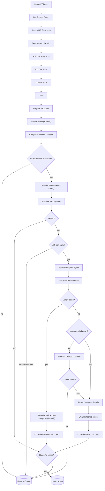

# Snov.io HR Prospect using n8n

An n8n workflow that finds HR / recruiter / talent-acquisition prospects in Hyderabad or any other preferred city through Snov.io, reveals their emails, **verifies on LinkedIn that each person is still at the company and in the role on record**, and re-finds the email at their new company when they have moved. Verified leads are written to a Google Sheet; everything uncertain goes to a review tab.

> **Why this exists.** An email address belongs to an employer. If a prospect has changed jobs, the address Snov.io returned is stale, and you have already paid a credit for it. This workflow spends credits on a verification step and discards or replaces emails that no longer apply.

---

## Table of contents

1. [How it works](#how-it-works)
2. [Flow diagram](#flow-diagram)
3. [Credit cost](#credit-cost)
4. [Requirements and setup](#requirements-and-setup)
5. [Node reference](#node-reference)
6. [The decision logic in detail](#the-decision-logic-in-detail)
7. [Status values](#status-values)
8. [Google Sheet schema](#google-sheet-schema)
9. [Error handling and polling](#error-handling-and-polling)
10. [Known limitations](#known-limitations)
11. [Customising](#customising)
12. [Security](#security)
13. [Project status](#project-status)

---

## How it works

1. **Search** Snov.io's prospect database for HR titles in Hyderabad, then filter by job title and location.
2. **Reveal** each prospect's email. Snov.io masks the LinkedIn URL and last name in search results; the reveal call returns the full values.
3. **Verify** on LinkedIn: fetch the profile and compare the person's *current* positions with the company and designation on record.
4. **Route** each person:
   - Company and designation match: **verified lead**, goes to `Leads`.
   - Same company, new title: **verified**, title updated, email kept.
   - Different company: the old email is discarded, the new company and title are taken from LinkedIn, the person is searched again at the new company and a fresh email is revealed. If the re-search finds no matching record, the workflow falls back to Snov.io's Email Finder (name plus company domain).
   - Anything unconfirmed, missing or ambiguous goes to the `Review Queue` with a reason.

The pipeline is deliberately **reveal first, verify second**. The LinkedIn URL is masked in search results, so verification cannot run before the reveal.

---

## Flow diagram

Each Snov.io call in the diagram is really a **Start, Wait, Get Result, Still Processing?** loop (see [Error handling and polling](#error-handling-and-polling)).

---

## Credit cost

Snov.io bills per successful result. The initial database search is free (limited to one page on free plans).

| Step | Credits |
|---|---|
| Reveal email | 1 per prospect with an email |
| LinkedIn profile lookup | 1 per profile returned |
| Domain lookup by company name (fallback only, skipped when LinkedIn already gives the company website) | 1 per domain found |
| Email Finder by name + domain (fallback only) | 1 per email with a `valid` or `unknown` status |
| Search again at new company | Free |
| Reveal email at new company | 1 |

Typical cost per person:

| Outcome | Credits |
|---|---|
| Still at company | about 2 |
| Moved, found by re-search | about 3 |
| Moved, re-search missed, Email Finder fallback | about 3 to 5 |

Check your balance before large batches. Snov.io's API is limited to **60 requests per minute**, and one person can trigger roughly 8 to 15 calls.

---

## Requirements and setup

**You need**
- An n8n instance (cloud or self-hosted)
- A Snov.io account with API access and credits (client ID and secret under *Account settings, API*)
- A Google account with a Google Sheets credential configured in n8n

**Steps**
1. Import the workflow JSON via *Workflows, Import from file*.
2. **Replace the Snov.io credentials.** The `Snov - Get Access Token` node takes a client ID and secret. Store them as n8n credentials or environment variables rather than pasting them into the node (see [Security](#security)).
3. **Create the Google Sheet** with two tabs, `Leads` and `Review Queue`, using the headers in [Google Sheet schema](#google-sheet-schema). Then re-select the spreadsheet and tabs in the `Append Approved Leads` and `Review_Queue` nodes and attach your Google Sheets credential.
4. **Set `Limit`.** The node ships with its default of 1 item. Use 3 to 5 for the first test, then raise it.
5. Click **Execute workflow**.

---

## Node reference

Node names match the workflow canvas. Every Snov.io request is authenticated with the token from `Snov - Get Access Token`.

### Stage 0: Prospect discovery (upstream)

| Node | Type | What it does |
|---|---|---|
| **When clicking 'Execute workflow'** | Manual Trigger | Starts a run. |
| **Snov - Get Access Token** | HTTP Request | OAuth client-credentials call; returns the bearer token used by all later calls. Tokens expire after 3600 seconds. |
| **Snov - Search HR Prospects** | HTTP Request | Starts a Snov.io database search: titles such as HR Manager, Talent Acquisition, Recruiter and HR Business Partner, department `human_resources`, city Hyderabad. Returns a `task_hash`. |
| **Snov - Get Prospect Results** | HTTP Request | Fetches the result for that `task_hash`. |
| **Split Out Prospects** | Split Out | Splits `data.prospects` into one item per person. |
| **Job Title Filter** | Filter (OR, case-insensitive) | Keeps titles containing `recruiter`, `HR Manager`, `HR ` (with trailing space), `Talent Acquisition`, `Recruiter Manager`, `Manager - HR` or `Manager, Human Resources`, plus the exact title `Human Resources manager`. |
| **Location Filter** | Filter (OR) | Keeps locations containing Hyderabad, Telangana or Andhra Pradesh. |
| **Limit** | Limit | Caps how many people are processed. Controls your credit spend. |

### Stage 1: Reveal the email

| Node | What it does |
|---|---|
| **Prepare Prospect** | Set node. Normalises fields: `first_name`, `last_name` (masked at this point), `job_title`, `location`, `industry`, `company_name`, `company_domain`, `reveal_url`. |
| **Snov - Reveal Email** | POSTs to the prospect's `email_and_hidden_info_reveal` URL. Costs a credit. |
| **Wait Reveal** | 4-second pause. |
| **Snov - Get Reveal Result** | Fetches the revealed record: full name, LinkedIn URL, emails with `smtp_status`. |
| **Reveal Still Processing?** | Loops back to the wait node while Snov.io reports `in_progress`. |
| **Compile Revealed Contact** | Code node. Merges the reveal with the prospect fields, prefers the email with `smtp_status = valid` (otherwise the first one), and stores `email`, `email_status`, the full last name and the unmasked `linkedin_url`. |
| **LinkedIn URL Available?** | IF. Checks the URL is a real `linkedin.com/in/...` address with no `*` masking. |
| **Tag No LinkedIn URL** | Set node. Marks `NOT_CHECKED_NO_LINKEDIN_URL` / `REVIEW_NO_LINKEDIN_URL` and sends the person to the Review Queue. |

### Stage 2: Verify on LinkedIn

| Node | What it does |
|---|---|
| **Snov - Start LinkedIn Enrichment** | Requests the full LinkedIn profile via `li-profiles-by-urls`. Costs a credit. |
| **Wait LinkedIn** | 6-second pause. |
| **Snov - Get LinkedIn Result** | Fetches the profile, including its `positions` array. |
| **LinkedIn Still Processing?** | Retry loop. |
| **Evaluate Employment** | The decision node. See [The decision logic in detail](#the-decision-logic-in-detail). |
| **Verified?** | IF. `VERIFIED` and `VERIFIED_TITLE_CHANGED` go to final routing; everything else goes to the next check. |
| **Left Company?** | IF. `LEFT_COMPANY` goes to Stage 3; other statuses (unconfirmed, no profile, no position) go straight to the Review Queue. |

### Stage 3: Re-search at the new company

| Node | What it does |
|---|---|
| **Snov - Search Prospect Again** | New database search filtered by the person's first name, last name and the *current* company name taken from LinkedIn. Free. |
| **Wait Search Again** | 4-second pause. |
| **Snov - Get Search Again Result** | Fetches the candidate list. |
| **Search Again Still Processing?** | Retry loop. |
| **Pick Re-Search Match** | Code node. Chooses the correct candidate or rejects all (see below). |
| **Re-Search Match Found?** | IF. Match goes to the new reveal; no match goes to the Email Finder fallback. |
| **Snov - Reveal Email (New Company)** | Reveals the email from the matched record. Costs a credit. |
| **Wait Reveal New** | 4-second pause. |
| **Snov - Get New Reveal Result** | Fetches the revealed record. |
| **New Reveal Still Processing?** | Retry loop. |
| **Compile Re-Searched Lead** | Builds the final record with the new company, title and fresh email. The old email is discarded and noted in the reason. Approved if an email was returned. |

**`Pick Re-Search Match` rules.** A candidate is accepted only if all of these hold:
- The first name is identical (case-insensitive).
- The candidate's last name (trailing `*` masking stripped) is a prefix of the known full last name.
- The candidate's company matches the new company by name or by domain.
- If the candidate's LinkedIn URL is partially masked, its visible stem must be a prefix of the known LinkedIn URL. This stops it picking a different person with the same name.
- The candidate has a reveal link.

When several candidates qualify, the highest score wins: 1 base point, plus 2 for a matching LinkedIn stem, plus 1 for having a reveal link.

### Stage 3b: Email Finder fallback

Used only when the re-search finds no matching record.

| Node | What it does |
|---|---|
| **New Domain Known?** | IF. If LinkedIn already supplied the new company's website, the domain lookup is skipped. |
| **Snov - Start Domain Lookup** | Finds the domain from the company name. Costs a credit. |
| **Wait Domain** / **Snov - Get Domain Result** / **Domain Still Processing?** | Wait and retry loop. |
| **Apply New Domain** | Code node. Saves the domain, or marks `REVIEW_NEW_COMPANY_DOMAIN_NOT_FOUND`. |
| **Domain Found?** | IF. No domain sends the person to the Review Queue. |
| **Target Company Ready** | No-op merge point for the "domain known" and "domain looked up" paths. |
| **Snov - Start Email Finder** | Finds an email from first name, last name and domain (`emails-by-domain-by-name`). Costs a credit. |
| **Wait Email Finder** / **Snov - Get Email Finder Result** / **Email Finder Still Processing?** | Wait and retry loop. |
| **Compile Re-Found Lead** | Builds the final record. Counts as a lead **only if `smtp_status = valid`**. `unknown` (for example catch-all domains) goes to the Review Queue with the reason. |

### Stage 4: Output

| Node | What it does |
|---|---|
| **Route To Leads?** | IF on `route_to_leads === true`. |
| **Append Approved Leads** | Appends to the `Leads` tab. |
| **Review_Queue** | Appends to the `Review Queue` tab, including `Email Status`. |
| **Flow Notes** | Sticky note on the canvas. No runtime effect. |

---

## The decision logic in detail

`Evaluate Employment` receives one person and the LinkedIn result, and returns an employment status, a lead status, a reason and a `route_to_leads` flag.

### 1. Early exits (go to Review Queue, email kept but unverified)

| Condition | `employment_status` |
|---|---|
| Lookup status is not `completed` (timed out or errored) | `UNCONFIRMED` |
| Snov.io returned no profile object | `NO_PROFILE_DATA` |
| Profile has no current positions | `NO_CURRENT_POSITION` |

### 2. Does any current position match the company on record?

A position matches if **either** is true:
- **Domain.** The position's website host equals the recorded company domain after stripping `http(s)://` and `www.`. Sub-domains match in both directions (`careers.acme.com` matches `acme.com`).
- **Name.** Both names are normalised: lower-cased, `&` becomes `and`, the suffixes `pvt`, `private`, `ltd`, `limited`, `llp`, `llc`, `inc`, `incorporated`, `corp`, `corporation`, `co` and `company` are removed, and punctuation is collapsed. They match if equal, or if one contains the other **and** the shorter is at least 4 characters.

### 3. If the company matches, does the designation?

Titles are compared by words, not exact text:
- `human resources` is treated as `hr`.
- `recruiter`, `recruiting` and `recruitment` are treated as `recruit`.
- Filler words (`and`, `of`, `the`, `for`, `a`) are dropped.
- Match if every word of the shorter title appears in the longer one (at least 2 words), or if the overlap is at least 60% of the combined words.

Examples: "HR Manager" matches "Senior HR Manager"; "HR Executive" does not match "HR Manager".

| Result | `employment_status` | Outcome |
|---|---|---|
| Company and title match | `VERIFIED` | Lead approved, title taken from LinkedIn. |
| Company matches, title differs | `VERIFIED_TITLE_CHANGED` | Lead approved, email kept (the employer drives the address, not the title), new title saved, change recorded in the reason. |

If the earlier reveal returned no email, both outcomes become `REVIEW_NO_EMAIL` and go to the Review Queue.

### 4. No position matches: the person has left

- The "new" position is the first one whose title looks HR-related (`hr`, `human resources`, `talent`, `recruit`, `people`, `hiring`, `staffing`), otherwise the first position.
- The new company name, title and (when the position has a website that is not a LinkedIn URL) the new domain are saved.
- The old email is **cleared** from `email` and kept in `old_email` for the audit trail.
- Status becomes `LEFT_COMPANY`, which triggers Stage 3.

### Worked examples

Record: *HR Manager* at *Acme Technologies Pvt Ltd* (`acme.com`).

| LinkedIn current positions | Result |
|---|---|
| Acme Technologies, Senior HR Manager | `VERIFIED` |
| Acme, Head of People | `VERIFIED_TITLE_CHANGED` |
| Zeta Corp, Talent Acquisition Lead (`zeta.io`) | `LEFT_COMPANY`: re-search at Zeta Corp, old email discarded |
| Empty profile | `NO_PROFILE_DATA` |
| Lookup never completed | `UNCONFIRMED` |

---

## Status values

**`employment_status`** (written to the sheet column `LinkedIn Lookup Status`)

`VERIFIED`, `VERIFIED_TITLE_CHANGED`, `LEFT_COMPANY`, `UNCONFIRMED`, `NO_PROFILE_DATA`, `NO_CURRENT_POSITION`, `NOT_CHECKED_NO_LINKEDIN_URL`

**`lead_status`** (written to the sheet column `Verification Decision`)

| Value | Meaning | Destination |
|---|---|---|
| `APPROVED_VERIFIED_CURRENT` | Still at the company, email revealed | Leads |
| `APPROVED_REFOUND_NEW_COMPANY` | Moved; fresh email via re-search or a `valid` Email Finder result | Leads |
| `LEFT_COMPANY_RESEARCHING` | Intermediate state during Stage 3 | (transient) |
| `REVIEW_NO_EMAIL` | Verified but the reveal returned no email | Review Queue |
| `REVIEW_LOOKUP_INCOMPLETE` | LinkedIn lookup did not finish | Review Queue |
| `REVIEW_NO_PROFILE` | No LinkedIn profile data | Review Queue |
| `REVIEW_NO_CURRENT_POSITION` | Profile lists no current position | Review Queue |
| `REVIEW_NO_LINKEDIN_URL` | No usable LinkedIn URL after reveal | Review Queue |
| `REVIEW_NEW_COMPANY_DOMAIN_NOT_FOUND` | Could not find the new company's domain | Review Queue |
| `REVIEW_NO_EMAIL_AT_NEW_COMPANY` | New company found, no email | Review Queue |
| `REVIEW_REFOUND_UNVERIFIED` | Email Finder returned only an `unknown` status | Review Queue |

---

## Google Sheet schema

Create these headers exactly (the nodes map by column name).

**`Leads` tab**

`First Name`, `Last Name`, `Job Title`, `Person Location`, `Company Name`, `Industry`, `Company Domain`, `Email Address`, `LinkedIn URL`, `LinkedIn Lookup Status`, `LinkedIn Profiles Found`, `Verification Decision`, `Verification Reason`

Optional columns for later outreach tracking: `Outreach Status`, `Email Sent At`, `Do Not Contact`.

**`Review Queue` tab**

All of the above plus `Email Status`.

**Column meaning**
- `Company Name`, `Company Domain` and `Job Title` hold the **final** values: LinkedIn's company and title for verified people, the new company for people who moved.
- `LinkedIn Lookup Status` holds the `employment_status`.
- `LinkedIn Profiles Found` holds the number of current positions found on LinkedIn.
- `Verification Reason` is a plain-English explanation, including the discarded old email where relevant.

---

## Error handling and polling

- **Polling.** Snov.io is asynchronous. Each call is a Start, Wait, Get Result loop. A *Still Processing?* IF node sends the item back to the wait node while `status === 'in_progress'`, up to **12 attempts** (`$runIndex < 12`). After that the item continues with an incomplete status and ends up in the Review Queue.
- **Errors do not stop the run.** Every HTTP node uses *Continue (regular output)* on error. A failed call, such as running out of credits, produces an item with an error and is handled by the downstream code node, usually landing in the Review Queue with the failure as the reason.
- **No position-based merges.** Each stage reads the original record directly (`$('Node').item.json`) instead of merging parallel branches by index, so a missing email cannot attach a contact to the wrong person.

---

## Known limitations

- **`positions` must contain current roles only.** The logic assumes Snov.io's `positions` array lists current jobs, as its docs describe. If real responses include past roles, someone who left could match their old employer and be marked verified. Test with a person you know has moved.
- **Re-search depends on Snov.io's data freshness.** If its database still lists the old company, the match is rejected and the Email Finder fallback runs.
- **Side roles count as employment.** An advisory or part-time role at the old company is treated as "still there".
- **Short company names can match too loosely** (name matching uses "contains" for names of 4 or more characters). The domain check protects most cases; skim name-only matches in early runs.
- **Location is not re-checked.** A person who moved cities but stayed at the company is still verified.
- **Reveal runs before verification**, so the first credit is spent even for people who turn out to have moved. This is forced by Snov.io masking the LinkedIn URL.
- **No deduplication.** Running the workflow twice processes and charges for the same people again. Add a lookup against the sheet if you schedule it.
- **Only the first page of search results is fetched.**
- **Manual trigger only.**

---

## Customising

| Want to change | Where |
|---|---|
| How many people per run | `Limit` node |
| Titles / city searched | Body of `Snov - Search HR Prospects` |
| Title and location filters | `Job Title Filter` and `Location Filter`. The `HR ` (with a trailing space) rule is loose and also matches unrelated titles, so consider tightening it. |
| Title-match strictness | `titleMatch` function in `Evaluate Employment` |
| Treat any title change as a re-search | In `Evaluate Employment`, send `VERIFIED_TITLE_CHANGED` down the `LEFT_COMPANY` path instead |
| Retry count / wait times | Wait nodes (seconds) and the `$runIndex < 12` expression in each *Still Processing?* node |
| Accept `unknown` Email Finder results as leads | `valid` check in `Compile Re-Found Lead` |
| Batching for rate limits | Batch size and interval in each HTTP node's options |

---

## Security

- The original workflow stores the Snov.io **client ID and secret in plain text** inside the `Snov - Get Access Token` node. **Do not commit them.** Rotate any secret that has been shared or committed, then move the values into n8n credentials or environment variables before exporting the workflow.
- Exported workflows also contain your Google Sheet ID and credential IDs. Remove or replace them before publishing.
- The sheets contain personal data (names, work emails, LinkedIn URLs). Handle them according to the privacy and anti-spam rules that apply to your outreach.

---

## Project status

The workflow structure, connections, node references and code-node syntax were validated, and the employment-matching and re-search matching logic was exercised against mock data. It has **not yet been run end to end against a live Snov.io account.** Field names come from Snov.io's public API documentation, so run it with `Limit` set to 3 to 5 first and inspect `Evaluate Employment` and the Review Queue reasons before scaling up.

**Reference:** [Snov.io API documentation](https://snov.io/api)
